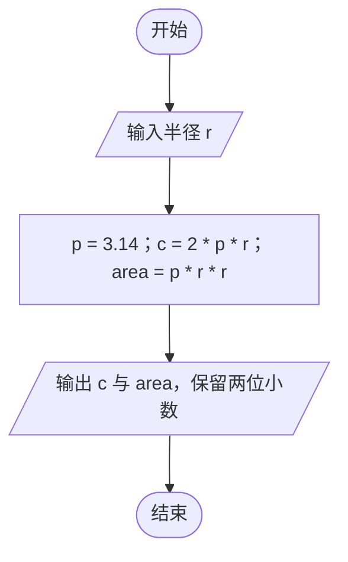
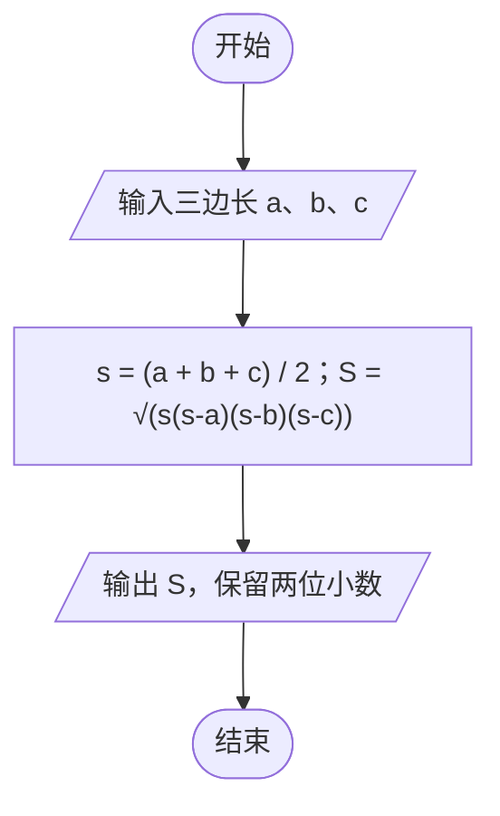
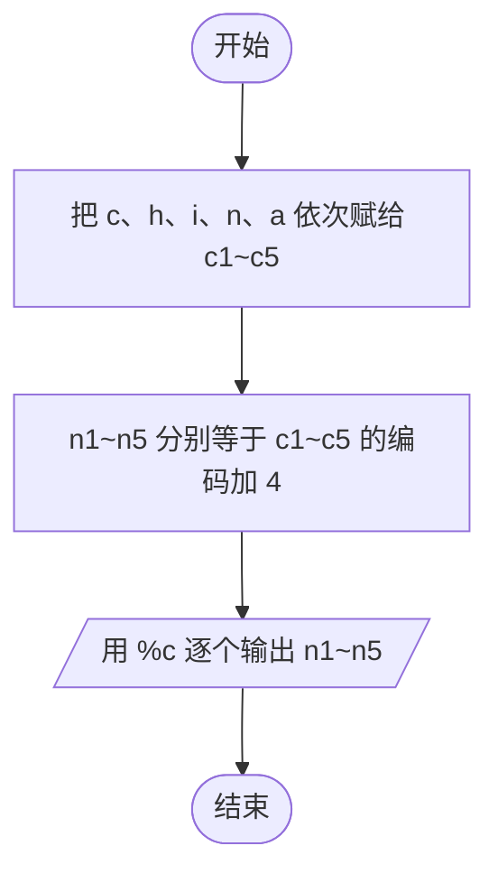
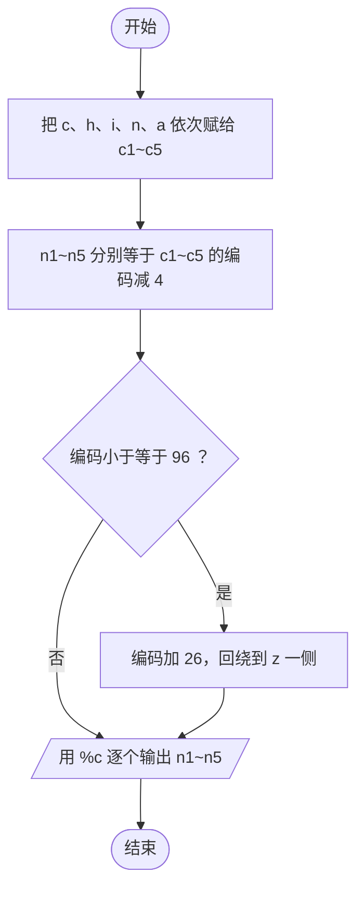

# 实验2 流程图集合

截图用 <https://mermaid.live/>：把下面的代码整段粘进左侧编辑器，右侧出图后截图，粘贴到报告的「实验原理」一节。
报告里已经放了同款渲染图，如果需要换成你自己的截图，删掉对应位置的原图再粘贴即可。

## 1. 实验2-1 圆面积与周长流程图

## 2. 实验2-2 三角形面积流程图

## 3. 实验2-4 正向译码流程图

## 4. 实验2-4 反向译码流程图（含编码越界回绕）

实验2-3 是阅读程序分析输出的实验，程序没有分支与循环，因此不画流程图，分析写进「实验结果与分析」即可。
