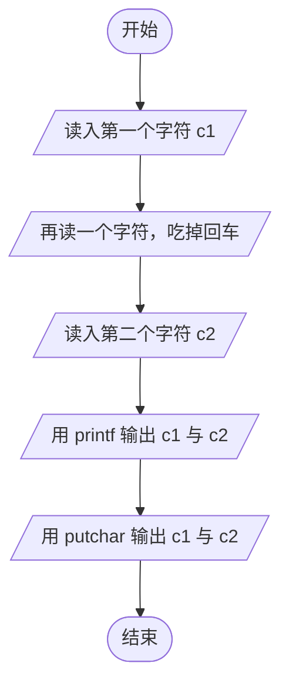
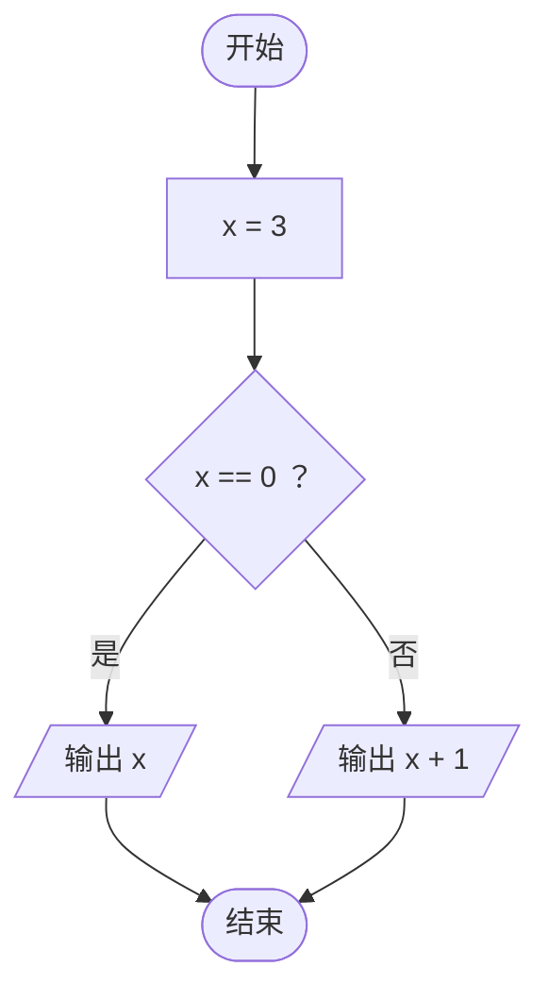
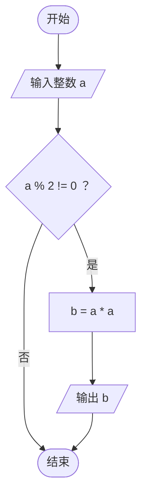
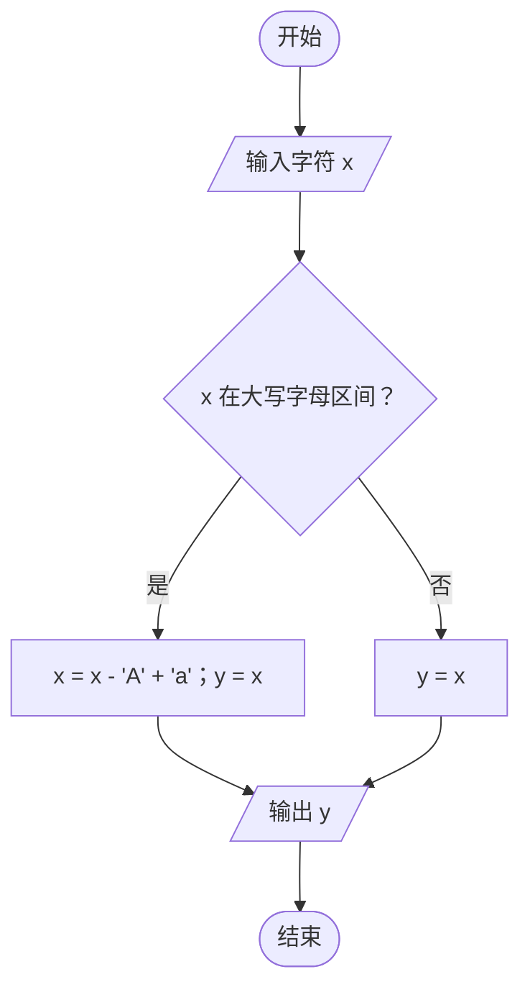
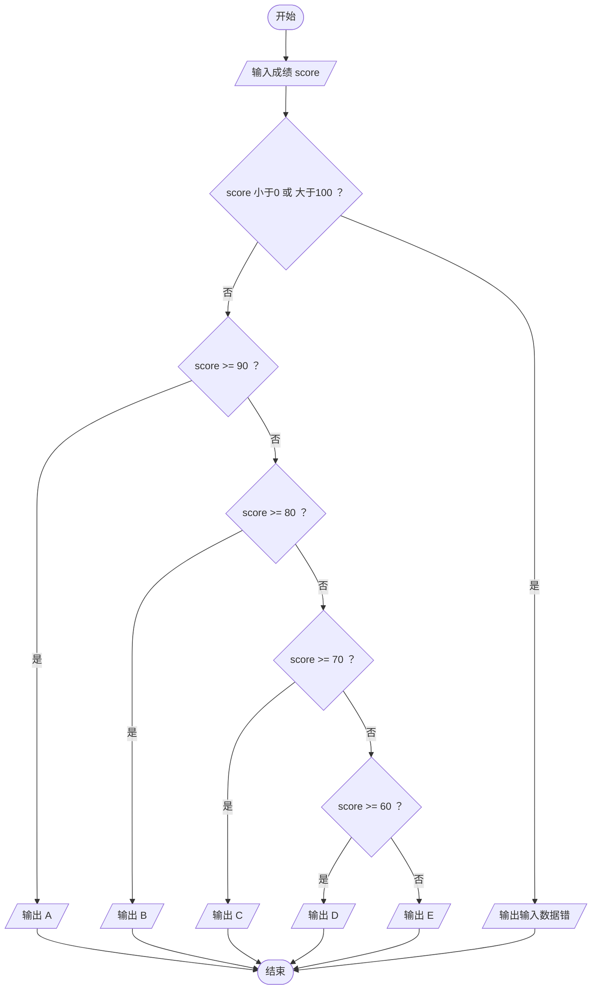
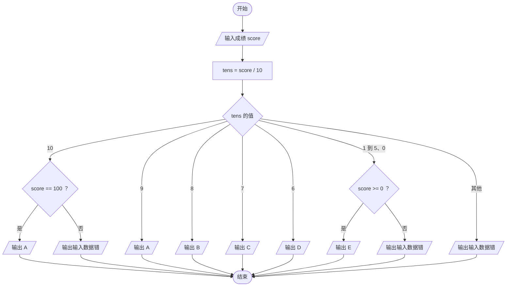

# 实验3 流程图集合

截图用 <https://mermaid.live/>：把下面的代码整段粘进左侧编辑器，右侧出图后截图。
报告里已经放了同款渲染图，需要换成自己的截图时，删掉对应位置的原图再粘贴。

## 1. 实验3-1 读字符与两种输出

## 2. 实验3-2.1 判断 x 是否为 0

## 3. 实验3-2.2 奇数求平方

## 4. 实验3-3 大写字母转小写

## 5. 实验3-4 成绩分级（if 版）

## 6. 实验3-4 成绩分级（switch 版）

